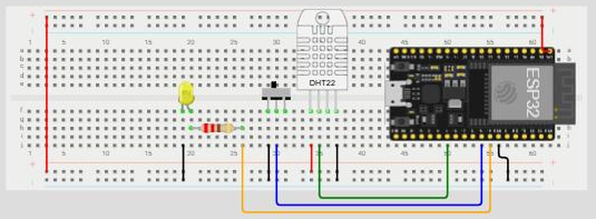

# FridgeGuard: Firmware ESP32 (PlatformIO + Wokwi)

Kode ESP32 FridgeGuard dalam bentuk project PlatformIO untuk VS Code. Satu project ini dipakai untuk dua hal:

- **Simulasi** di Wokwi, langsung dari VS Code (tanpa alat).
- **Upload** ke ESP32 asli.

Yang membedakan cuma satu baris di `src/main.cpp`: `#define MODE_WOKWI 1` untuk simulasi, `0` untuk alat asli.

## Isi folder

| File | Fungsi |
|---|---|
| `platformio.ini` | Pengaturan board (ESP32 Dev Module), framework Arduino, dan library. Library diunduh otomatis, tidak perlu install manual. |
| `src/main.cpp` | Kode utama ESP32. |
| `diagram.json` | Rangkaian untuk simulasi Wokwi (gambar di atas). |
| `wokwi.toml` | Memberi tahu Wokwi letak file hasil build. |

Library yang dipakai: DHT sensor library, Adafruit Unified Sensor, PubSubClient.

## Persiapan (sekali saja)

1. Install **VS Code**.
2. Install extension **PlatformIO IDE**.
3. Install extension **Wokwi Simulator**, lalu aktifkan lisensinya: tekan `F1`, pilih **Wokwi: Request a New License**, login/daftar akun Wokwi (gratis), lalu konfirmasi di browser. Setiap orang perlu lisensi sendiri.

## Membuka project

Di VS Code pilih **File > Open Folder**, lalu pilih folder **`firmware/FridgeGuard_PIO`** ini, bukan folder repo paling luar. PlatformIO hanya mengenali project kalau `platformio.ini` ada di folder yang dibuka.

Pertama kali dibuka, PlatformIO akan mengunduh platform ESP32 dan library. Tunggu sampai selesai (bisa beberapa menit).

Tombol yang dipakai ada di status bar paling bawah VS Code:

| Tombol | Fungsi |
|---|---|
| ✓ | Build (compile kode) |
| → | Upload ke ESP32 (sekalian build) |
| Ikon colokan | Serial Monitor (115200) |

## Simulasi di Wokwi

1. Pastikan di `src/main.cpp` tertulis `#define MODE_WOKWI 1`.
2. Klik **✓ (Build)**.
3. Tekan `F1`, pilih **Wokwi: Start Simulator**.
4. Output serial muncul di terminal VS Code.

Cara mencoba di simulasi:

- **Slide switch** menggantikan magnetic switch: geser ke **kiri = pintu tertutup**, ke **kanan = pintu terbuka**.
- Klik **DHT22** untuk mengubah suhu dan kelembapan.
- Setelah mengubah kode, cukup klik ✓ lagi. Wokwi otomatis memuat firmware baru.

Catatan: board ESP32 di Wokwi tidak punya LED biru bawaan, jadi LED biru (D2) tidak kelihatan di simulasi. Di alat asli tetap menyala.

## Upload ke alat asli

1. Ubah jadi `#define MODE_WOKWI 0`.
2. Isi `WIFI_SSID` dan `WIFI_PASS` di bagian `#else` (di bawah baris `#if MODE_WOKWI`). ESP32 hanya bisa WiFi **2.4 GHz**; hotspot HP paling aman.
3. Colok ESP32 ke laptop, klik **→ (Upload)**.
4. Klik **ikon colokan** untuk Serial Monitor, tunggu tulisan `[MQTT] Konek ke broker... OK`.

> **Penting sebelum push ke GitHub:** kosongkan lagi `WIFI_SSID` dan `WIFI_PASS`, dan kembalikan `MODE_WOKWI` ke `1`. Repo ini bisa dilihat orang lain, jadi password WiFi jangan ikut ter-push.

## Rangkaian

Sama di alat asli dan di Wokwi.

| Komponen | Sambungan |
|---|---|
| DHT22 (modul `+ out -`) | `+` ke 3V3, `-` ke GND, `out` ke D4 (GPIO4) |
| Magnetic switch | kabel 1 ke D18 (GPIO18), kabel 2 ke GND |
| LED kuning | D19 (GPIO19) ke resistor 220 ohm ke kaki panjang LED, kaki pendek ke GND |
| LED biru | bawaan board, D2 (GPIO2) |

Di Wokwi, magnetic switch diganti slide switch: pin tengah ke GPIO18, pin kiri ke GND.

## Cara kerja

| Kondisi | LED |
|---|---|
| Pintu tertutup | Semua mati |
| Pintu terbuka sampai 5 detik | LED kuning menyala |
| Pintu terbuka lebih dari 5 detik | LED kuning + biru berkedip (peringatan) |

Data dikirim ke broker publik HiveMQ (`broker.hivemq.com`) dan dibaca dashboard web:

| Topik | Isi | Retained |
|---|---|---|
| `fridgeguard/kel-7/data` | JSON tiap 1 detik: `suhu`, `lembap`, `pintu`, `alarm`, `buka_detik`, `uptime`, `ts` (jam kirim dari internet/NTP) | Ya |
| `fridgeguard/kel-7/pintu` | `TERBUKA` / `TERTUTUP` saat berubah | Ya |
| `fridgeguard/kel-7/alarm` | `ON` / `OFF` saat berubah | Ya |
| `fridgeguard/kel-7/status` | `online` / `offline` (offline otomatis kalau ESP32 putus) | Ya |

Karena semua topik retained, broker selalu menyimpan data terakhir. Dashboard yang baru dibuka langsung menampilkan pembacaan terakhir beserta jamnya, walaupun ESP32 sedang mati.

## Kalau ada masalah

| Masalah | Solusi |
|---|---|
| Wokwi bilang firmware tidak ditemukan | Klik ✓ (Build) dulu, baru Start Simulator. |
| Upload gagal / port tidak terdeteksi | Tutup Arduino IDE atau Serial Monitor lain yang masih tersambung ke ESP32. Pastikan driver CH340 (chip USB di board) sudah terpasang. |
| Alat asli tidak konek WiFi | Cek `MODE_WOKWI` sudah `0`, SSID/password benar, dan WiFi-nya 2.4 GHz. |
| Data di dashboard campur aduk | Jangan menyalakan simulasi Wokwi dan alat asli bersamaan, karena keduanya kirim ke topik yang sama. |
